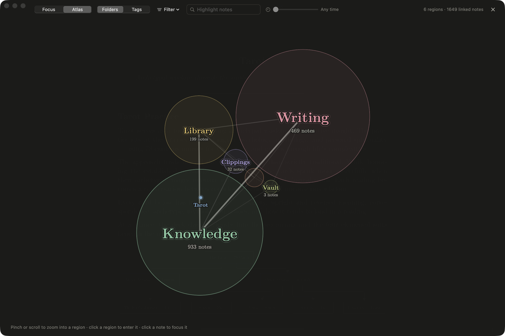

<p align="center">
  
</p>

<h1 align="center">Onyx</h1>

<p align="center"><b>Notes, typeset.</b><br>
A native macOS notes app for plain Markdown.<br>
Obsidian-compatible, quiet, and fast. Your vault stays yours.</p>

<p align="center">
  
</p>

---

Onyx opens a folder of `.md` files and gets out of the way. It edits like a calm text editor and reads like a typeset page — Latin Modern, justified, hyphenated. Your Obsidian vault opens as-is. Obsidian can keep running right alongside it. There is no database, no account, and no lock-in.

## Quick start

Requires macOS 14+ and Swift 5.10 (Xcode 15.3 or newer). There is no Xcode project: it is a Swift package, built from Terminal.

```sh
make run                       # build Onyx.app and open your vault
make run VAULT=~/path/to/vault # any folder of Markdown; does not change the remembered vault
make run-test                  # the disposable test copy (/tmp/onyx-vault), never ~/Notes
make app                       # build Onyx.app in build/
make test                      # Swift tests, then the reader tests
make install                   # copy Onyx.app to /Applications
```

With no `--vault`, Onyx opens the last vault you chose, or `~/Notes` if that folder exists. A vault in `/tmp` is never remembered, so test copies don’t stick. `ONYX_NO_DEFAULT_VAULT=1` skips the fallback entirely (used by `make run-test` and `make dev`).

To leave git or Obsidian Sync alone for a session:

```sh
ONYX_NO_GIT=1 make run         # don’t auto-commit, pull, or push
ONYX_NO_SYNC=1 make run        # don’t start Obsidian Sync, even if this vault is connected
```

## Writing and reading

<p align="center"></p>

Two modes, one keystroke. The editor is IBM Plex Mono with live Markdown styling. The reader is the Reitz LaTeX theme: a measure you can set, Tufte-style sidenotes, footnotes, tables, callouts, and Mermaid figures. <kbd>⌘↩</kbd> (or <kbd>⌘E</kbd>) flips between them, saves, and keeps your place in the note. A single newline inside a paragraph is a line break, the way Obsidian does it unless “Strict line breaks” is on.

Typeset reading (on by default, Settings ▸ Typesetting) sets the page the way a book would: curly quotes and real dashes (never inside code), true small caps for acronyms, old-style figures in prose and lining tabular figures in tables, hyphenation in the note’s `lang`, hanging punctuation, a small-caps lead-in or drop cap, epigraphs, booktabs tables, and numbered figure and table captions. Choose Latin Modern or ET Book. Sidenotes stack and never collide, and they reflow when fonts, images, or the window change. Write `[^n]: {-} …` for an unnumbered margin note. When the window is narrow, notes fold behind a tap. Turn it off to get the plain Reitz LaTeX page back.

File ▸ Export as PDF… (<kbd>⇧⌘E</kbd>) and Print… (<kbd>⌥⌘P</kbd>) lay the note out as a book page. You get sidenotes as margin notes, a running head in small caps, and folios, and links keep working.

Frontmatter, `%%comments%%`, embeds, images, PDFs, audio and video all render in the reader. Dataview-lite runs the `TABLE` and `LIST` queries a vault actually uses (`FROM`, `WHERE`, `SORT`, `LIMIT`, and functions such as `choice()`, `join()`, and `contains()`). Kanban boards written by the Obsidian Kanban plugin are shown as columns of cards (viewing only, for now). <kbd>⌥⌘R</kbd> turns on RhymePad highlighting for verse.

Saves are atomic and conflict-aware: if the file changed on disk, Onyx offers to keep yours, take theirs, or keep both. Light, dark, or auto, text size, and line measure live in <kbd>⌘,</kbd>. <kbd>⌃⌘F</kbd> is focus mode — just the text.

Split with <kbd>⌘D</kbd> (side by side) or <kbd>⇧⌘D</kbd> (stacked), up to four panes. Each pane keeps its own note, its own history, and its own read/edit mode. <kbd>⌘W</kbd> closes the focused pane, or the window when there is only one.

## Linking and the graph

Wikilinks work the way they do in Obsidian: `[[Note]]`, aliases, headings, and `![[embeds]]`. Type `[[` and a quiet popup offers existing notes; you can also type a name that does not exist yet. <kbd>⌘</kbd>-click a link in the editor to follow it. Clicking an unresolved link creates the note.

Dataview fields are first-class relationships. `partOf:: Knowledge` (or `partOf:: [[Knowledge]]`), `related::`, and a few synonyms become link chips, count as links, draw their own graph edges, and list Part of / Parts / Related in the inspector. Renames update those fields the same way they update wikilinks. Hover a link, an inspector relation, or the title-bar graph button for a small graph card of that note; click a node in the card to open it.

The *focus graph* (<kbd>⌘G</kbd>) puts the current note at the center with its links around it; you travel by clicking. The *atlas* (<kbd>⇧⌘G</kbd>) zooms out to the whole vault as colored regions (folders or tags) that open into sub-regions and notes as you zoom. Filter by folder, tag, or recency; orphans are off until you ask for them. The graph button sits in the title bar, right of the forward arrow: click for the focus graph, shift-click or right-click for the atlas.

<kbd>⌥⌘G</kbd>, or the dock button on the graph overlay, keeps the graph open as a pane beside your notes. A docked focus graph follows the note you’re on, never steals the editor’s focus, and <kbd>⌘W</kbd> closes it first when it’s the extra pane. Settings has “Open the atlas on startup,” remembered per vault; it defaults to on when the vault’s Obsidian Homepage plugin opens Graph view at launch.

## Canvas

Obsidian's `.canvas` boards (JSON Canvas) open from the sidebar, <kbd>⌘O</kbd>, links, backlinks, and the graph. Text cards are typeset like the reader; note cards show the note (or one heading of it), and images, PDFs, links, and groups are drawn quietly, with Obsidian's six colors as tints. Connections curve out of the side they leave from, with arrows, labels, and colors.

Two-finger scroll pans, pinch zooms, and <kbd>⇧1</kbd> zooms to fit. Everything is editable: drag to move (a group carries its cards), drag an edge to resize, double-click empty space for a card, double-click a card to type in it or open its note, drag from the dots on a card's sides to connect, <kbd>⌫</kbd> to delete, <kbd>⌘Z</kbd> to undo. Right-click adds cards, notes, and groups and sets colors and arrows. Canvases are saved in Obsidian's exact format, ids and unknown fields included, so both apps can share them, and they count as linking to their cards in backlinks and the graph.

<p align="center">
  
  
</p>

The inspector (<kbd>⌘I</kbd>) holds the outline, backlinks, and properties. Backlinks also appear in the footer when you hover it.

## Getting around

<kbd>⌘O</kbd> is the quick switcher. It ranks exact matches first, then prefix, initials, substring, and fuzzy; it ignores accents, matches folders and aliases (“hebrew aleph”, “hl”, “resume” → Résumé), and highlights what matched. <kbd>⌘↩</kbd> opens in a split; <kbd>⇧↩</kbd> creates a note. <kbd>⌘P</kbd> (or <kbd>⇧⌘P</kbd>) is every command.

The title path whispers the folder above the page; click a segment to reveal it in the sidebar and open its folder note. <kbd>⌘[</kbd> and <kbd>⌘]</kbd> go back and forward per pane (mouse buttons and swipe too). Daily notes follow the vault’s own `.obsidian/daily-notes.json` folder; <kbd>⌘T</kbd> or <kbd>⌘\</kbd> opens today, <kbd>⌥⌘[</kbd> and <kbd>⌥⌘]</kbd> step through them. <kbd>⇧⌘H</kbd> opens the homepage from the Obsidian Homepage plugin, or `Home.md`.

## Files and the sidebar

<kbd>⌘K</kbd> shows or hides the file list. The sidebar can be dragged as narrow as 140pt, the inspector as narrow as 150pt; double-click the edge to reset. Tabs cover files, vault search (<kbd>⇧⌘F</kbd>), recent files, bookmarks, tags, and source control.

Sort the sidebar by name (natural order, so “Note 2” precedes “Note 10”), modified, or created, ascending or descending, with folders on top if you want. The choice is remembered per vault. Right-click a folder to override the sort for just that folder, or to create a new note there.

Shift-click selects a range; <kbd>⌘</kbd>-click adds or removes one file without changing the open note. Right-click the selection to move, reveal in Finder, or delete them all (one confirmation, one git commit). <kbd>Esc</kbd> clears the selection; after clicking in the sidebar, <kbd>⌘⌫</kbd> deletes it.

Rename or Move to… (<kbd>⇧⌘M</kbd>) from the File menu or a right-click. Wikilinks — including path links, aliases, headings, embeds, and bare `partOf::` / `related::` names — are rewritten to follow, and the note stays open. Standard Markdown links (`[text](folder/note.md)`) are not rewritten yet. Delete sends files to the Trash after a confirm. “Open in Obsidian” is on the same menu, for a note you want to check in the official app.

## Sync

### Git, continuously

If the vault is a git repository and `git` is installed, Onyx uses it without being asked. It commits a moment after you stop typing (the message names the notes), and immediately on delete, rename, move, switching notes, or quit. It pulls with `--rebase` on launch, on focus, before each push, and every 30 seconds, then pushes. It never force-pushes and never rewrites published history. On a rebase conflict, your version keeps the path and the incoming one is saved beside it as `Note (conflict YYYY-MM-DD HHMM).md`; both are committed. Anything unexpected aborts the rebase and leaves your branch as it was.

A tiny footer glyph shows synced, syncing, offline, local-only, or conflict. `ONYX_NO_GIT=1` turns this off for a session.

### Obsidian Sync, optional

Off by default, and opt-in per vault. In Settings ▸ Obsidian Sync, sign in to your Obsidian account (2FA is supported), pick a remote vault, enter its encryption password, preview what the first sync will do, then connect. Onyx speaks Obsidian’s end-to-end encrypted protocol and merges Markdown the way Obsidian does. Credentials live in the macOS Keychain; the sign-in token is not read until you actually use Sync, so a rebuild should not prompt you for the keychain unless Sync is connected.

Safety rails: the first sync never deletes on either side, and differing files are kept twice. A mass deletion or an empty-looking vault folder pauses for confirmation instead of propagating. Local deletions go to the Trash; overwritten Markdown is backed up first. `ONYX_NO_SYNC=1` leaves it alone for a session.

This is unofficial and still new. Try it on a throwaway vault before pointing it at the real one. If you’d rather not use it, Obsidian’s official [`obsidian-headless`](https://www.npmjs.com/package/obsidian-headless) CLI (`npx obsidian-headless`) can keep a folder in sync while Onyx simply edits the files. Protocol notes are in [docs/obsidian-sync-protocol.md](docs/obsidian-sync-protocol.md).

After a rebuild, macOS may ask for Keychain access if the app was signed ad hoc (the signature changes every build). `make app` signs with an Apple Development or Developer ID identity if you have one, otherwise with a stable local “Onyx Local Signing” identity. Create that once with `scripts/make-signing-cert.sh`. Then “Always Allow” lasts across rebuilds.

## Keys

| Key | Does |
| --- | --- |
| <kbd>⌘O</kbd> | Quick switcher: find or create a note (<kbd>⌘↩</kbd> opens in a split, <kbd>⇧↩</kbd> creates) |
| <kbd>⌘P</kbd> · <kbd>⇧⌘P</kbd> | Command palette |
| <kbd>⇧⌘O</kbd> | Open vault… |
| <kbd>⌘K</kbd> | Show or hide the sidebar (opens on Files) |
| <kbd>⇧⌘F</kbd> | Search the vault |
| <kbd>⌘I</kbd> | Inspector: outline, backlinks, properties |
| <kbd>⌥⌘1</kbd> · <kbd>⌥⌘2</kbd> · <kbd>⌥⌘3</kbd> | Outline · backlinks · properties |
| <kbd>⌘G</kbd> · <kbd>⇧⌘G</kbd> · <kbd>⌥⌘G</kbd> | Focus graph · atlas · graph in a pane |
| <kbd>⌘F</kbd> · <kbd>⌥⌘F</kbd> | Find in the note (editor or reader) · find and replace (editor). While the bar is open, <kbd>⌘G</kbd>/<kbd>⇧⌘G</kbd> or <kbd>↩</kbd>/<kbd>⇧↩</kbd> go to the next/previous match, and <kbd>Esc</kbd> closes it |
| <kbd>⌘↩</kbd> · <kbd>⌘E</kbd> | Read ⇄ edit, and save |
| <kbd>⌘T</kbd> · <kbd>⌘\\</kbd> | Today’s daily note |
| <kbd>⌥⌘[</kbd> · <kbd>⌥⌘]</kbd> | Previous / next daily note |
| <kbd>⇧⌘H</kbd> | Homepage |
| <kbd>⌘D</kbd> · <kbd>⇧⌘D</kbd> | Split side by side · stacked |
| <kbd>⌘W</kbd> | Close the focused pane (the window, when there’s one pane) |
| <kbd>⌃⇥</kbd> · <kbd>⌃⇧⇥</kbd> | Next / previous pane |
| <kbd>⌘[</kbd> · <kbd>⌘]</kbd> | Back / forward (per pane; mouse buttons and swipe too) |
| <kbd>⌘⌫</kbd> | Delete note (to the Trash, after a confirm). After clicking in the sidebar, deletes the selection |
| <kbd>⇧</kbd>/<kbd>⌘</kbd>-click | Sidebar multi-select (range / toggle); right-click to Move, Reveal, or Delete them all; Esc clears |
| <kbd>⇧⌘M</kbd> | Move note to… a folder (fuzzy; type a new name to create one). Rename from File or right-click |
| <kbd>⌘N</kbd> | New note |
| <kbd>⌃⌘F</kbd> | Focus mode: just the text |
| <kbd>⌥⌘0</kbd> | Three-pane workspace (sidebar + page + inspector) |
| <kbd>⌘,</kbd> | Settings |
| <kbd>Esc</kbd> | Put away whatever’s on top |

Every command is also in the menu bar with its shortcut. The first-run hint sheet lists the everyday ones; Note ▸ Show Shortcut Hints brings it back.

## Obsidian compatibility

Onyx is built to open an Obsidian vault without converting anything. It understands wikilinks (aliases, headings, embeds), frontmatter, nested tags, folder notes, `%%comments%%`, callouts, footnotes, and Mermaid. It reads a few things out of `.obsidian`: the daily-notes folder, default view mode, user ignore filters, bookmarks, and the Homepage plugin’s start note.

What it does not do yet: edit Kanban boards, open `.canvas` files, or rewrite standard Markdown links when a note is renamed. It is not a plugin host, and it does not implement Templates, Excalidraw, or Bases. You can keep using Obsidian for those, and “Open in Obsidian” is one click away.

## Privacy

Your notes live in a folder you choose. Onyx does not require an account and does not phone home. The only network it uses, and only if you ask it to, is:

- **Git**, to the remotes already configured on that vault.
- **Obsidian Sync**, if you connect a vault under Settings. Tokens and encryption keys stay in the Keychain; file contents are encrypted with Obsidian’s protocol before they leave the machine. Sync hosts are limited to `*.obsidian.md`.
- **Rhyme view** (<kbd>⌥⌘R</kbd>), which sends the current note (with non-verse text masked) to [rhymepad.org](https://rhymepad.org) for analysis.

## In progress

These are underway, and not in the build yet:

- Backlinks at the bottom of reading view, not only in the inspector
- <kbd>⌘F</kbd> to find text in the current note
- Editable Kanban boards
- Viewing and editing Obsidian `.canvas` files
- Rewriting standard Markdown links on rename and move

Early days, moving fast. It is tested against a real vault of a few thousand notes, but expect rough edges. Back up your vault — or point Onyx at a copy — while it settles.

## Development

```
Sources/OnyxCore     vault index, parsing, link resolution, Dataview-lite, graph layout
Sources/Onyx         the macOS app (SwiftUI + AppKit, WKWebView reader)
Sources/OnyxSync     Obsidian Sync protocol
Sources/OnyxSyncPOC  a small command-line client for the same protocol
Tests/               OnyxCore and OnyxSync tests; Tests/reader for the typography
```

`make test` runs `swift test`, then `node --test Tests/reader`. Design notes live in [DESIGN.md](DESIGN.md).

## License

Onyx is licensed under the [GNU Affero General Public License v3.0](LICENSE).
