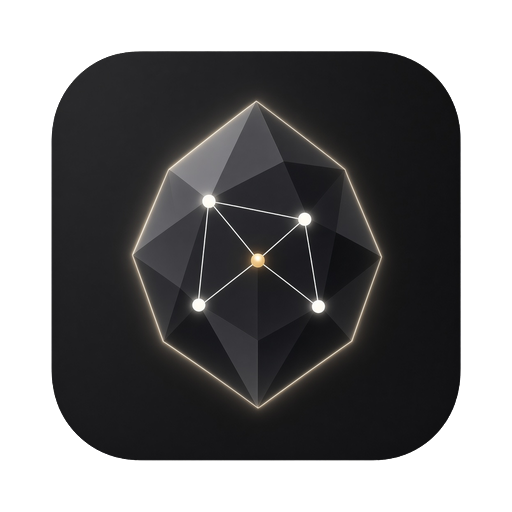

  

<h1 align="center">Onyx</h1>

<b>Notes, typeset.</b> 
A native Mac app for your Obsidian vault, typeset like a book.

  

---

- **Typeset reading** — small caps, collision-free sidenotes, hyphenation, the page as a book
- **PDF and print** — the note as a book page, with margin notes and a running head
- **Graph and atlas** — travel by clicking nodes, or zoom out over the whole vault
- **Canvas, Kanban, and Bases** — Obsidian boards and `.base` views, in place
- **Wikilinks, daily notes, and search** — the usual, without the chrome
- **Obsidian Sync and git** — optional, and only if you ask

## Download

The latest build is on the [releases page](https://github.com/kennethreitz/onyx/releases/latest). Unzip it and drag `Onyx.app` to `/Applications`.

This build is not notarized, so the first launch needs System Settings ▸ Privacy & Security ▸ **Open Anyway**. It updates itself from v0.1.1 on. Requires macOS 14 (Sonoma) or later, Apple silicon.

## Docs

- [Reading](docs/reading.md) — typography, sidenotes, PDF and print
- [Graph and atlas](docs/graph.md)
- [Bases](docs/bases.md)
- [Canvas and Kanban](docs/boards.md)
- [Getting around](docs/navigation.md)
- [Sync](docs/sync.md)
- [Keyboard shortcuts](docs/shortcuts.md)
- [Compatibility and privacy](docs/compatibility.md)
- [Building from source](DEVELOP.md)

## License

Onyx is licensed under the [GNU Affero General Public License v3.0](LICENSE).
