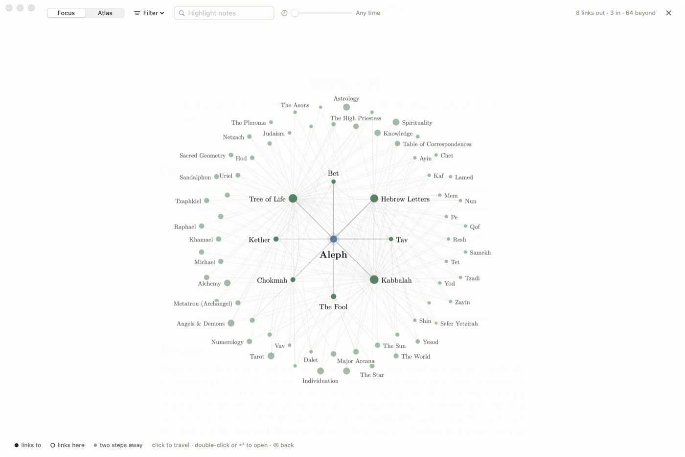

# Graph and atlas

Wikilinks work the way they do in Obsidian: `[[Note]]`, aliases, headings, and `![[embeds]]`. Type `[[` and a quiet popup offers existing notes; you can also type a name that does not exist yet. Fields complete too: type a word and a colon at the start of a line (`part:`) and the same popup offers the field keys your vault already uses (`partOf::`); after `partOf:: `, `related:: `, or any key you’ve used with a link, it offers notes and writes `[[Note]]`. Nothing is inserted until you pick a row (↑↓ then ↩, or click); Esc closes it for that line. <kbd>⌘</kbd>-click a link in the editor to follow it. Clicking an unresolved link creates the note.

Dataview fields are first-class relationships. `partOf:: Knowledge` (or `partOf:: [[Knowledge]]`), `related::`, and a few synonyms become link chips, count as links, draw their own graph edges, and list Part of / Parts / Related in the inspector. Parts open as a collapsible tree, siblings fold under a count, and any other key whose values are links (`treats:: [[Anxiety]]`) gets its own group, outgoing and incoming (“treats · from”). Renames update those fields the same way they update wikilinks. Hover a link, an inspector relation, or the title-bar graph button for a small graph card of that note; click a node in the card to open it.

The *focus graph* (<kbd>⌘G</kbd>) opens as an overlay on the current pane, over the note you’re in, with the current note at the center and its links around it. Click a node to travel and re-center; double-click or <kbd>↩</kbd> opens that note in the pane and closes the overlay; <kbd>Esc</kbd> dismisses it and puts you back in the note underneath. In a split, only that pane is covered. The *atlas* (<kbd>⇧⌘G</kbd>) uses the same overlay and zooms out to the whole vault as colored regions (folders or tags) that open into sub-regions and notes as you zoom. Filter by folder, tag, or recency; orphans are off until you ask for them. In the focus graph, `partOf` spokes are firmer stems with a small chevron pointing from part to parent, and Filter ▸ Hierarchy only (partOf) narrows the rings to parents, parts, and their parents and parts (remembered). The graph button sits in the title bar, right of the forward arrow: click for the focus graph, click again to close it and return to the note, shift-click or right-click for the atlas.

<kbd>⌥⌘G</kbd>, or the dock button on the graph overlay, keeps the graph open as a pane beside your notes. A docked focus graph follows the note you’re on, never steals the editor’s focus, and <kbd>⌘W</kbd> closes it first when it’s the extra pane. Settings has “Open the atlas on startup,” remembered per vault; it defaults to on when the vault’s Obsidian Homepage plugin opens Graph view at launch.

  

The inspector (<kbd>⌘I</kbd>) holds the outline, backlinks, and properties. Backlinks also appear at the bottom of the reader, and in the footer when you hover it.

See also [keyboard shortcuts](shortcuts.md).
