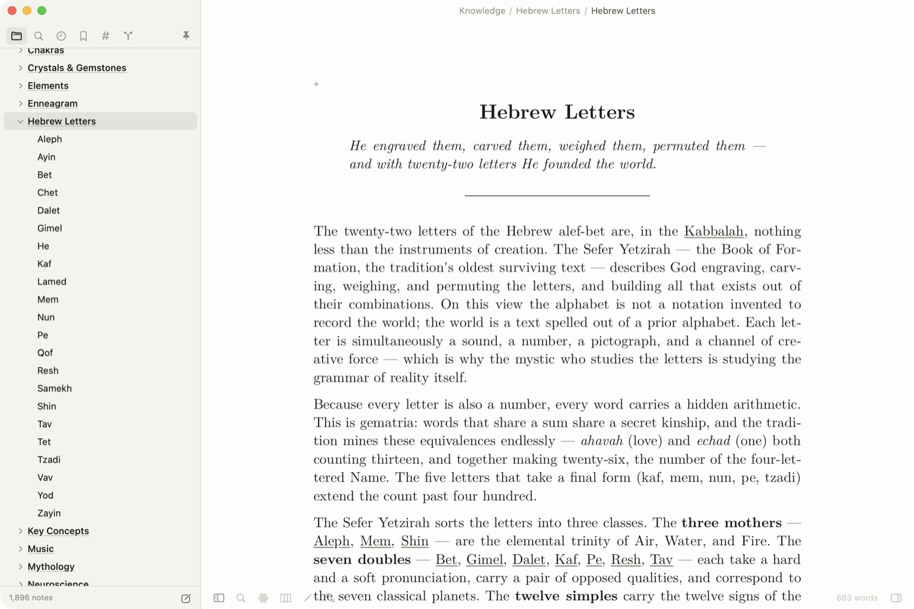

# Getting around

<kbd>⌘O</kbd> is the quick switcher. It ranks exact matches first, then prefix, initials, substring, and fuzzy; it ignores accents, matches folders and aliases (“hebrew aleph”, “hl”, “resume” → Résumé), and highlights what matched. <kbd>⌘↩</kbd> opens in a split; <kbd>⇧↩</kbd> creates a note. <kbd>⌘P</kbd> (or <kbd>⇧⌘P</kbd>) is every command, including Read Aloud, which speaks the note or your selection with the Mac’s voices (Settings ▸ Reading).

<kbd>⌘D</kbd> splits side by side and <kbd>⇧⌘D</kbd> stacks, up to four panes. The axis, divider positions, and the note in each pane are remembered per vault and come back when you reopen it.

The title path whispers the folder above the page; click a folder segment to reveal it in the sidebar and open its folder note. The current note’s name is just the name. When the note has a `partOf::` parent, the path shows its ancestry instead (`Medication › SSRI › Sertraline`); click an ancestor to open it. A note with several parents follows the first and shows a faint +N menu for the rest, and a loop stops where it repeats. A frontmatter `class:` shows as a small tag after the name; click it to open the class note if there is one. <kbd>⌘[</kbd> and <kbd>⌘]</kbd> go back and forward per pane (mouse buttons and swipe too). Attachments (images, PDFs, audio, video, other files) open in the pane and join that history, so ⌘[ from a PDF returns to the note you clicked it in. A file view turns off the swipe so panning an image doesn't navigate ([Attachments](attachments.md#opening-attachments)). Daily notes follow the vault’s own `.obsidian/daily-notes.json` folder; <kbd>⌘T</kbd> or <kbd>⌘\</kbd> opens today, <kbd>⌥⌘[</kbd> and <kbd>⌥⌘]</kbd> step through them. <kbd>⇧⌘H</kbd> opens the homepage from the Obsidian Homepage plugin, or `Home.md`. Open Random Note, in the Go menu or the command palette, jumps to a random Markdown note in the vault, skipping the one you’re on when it can.

<kbd>⇧⌘F</kbd> searches the vault. <kbd>⌘F</kbd> finds in the current note (editor or reader); <kbd>⌥⌘F</kbd> is find and replace in the editor.

  

## Files and the sidebar

<kbd>⌘K</kbd> shows or hides the file list. The sidebar is always docked — it does not float or auto-hide. It can be dragged as narrow as 140pt, the inspector as narrow as 150pt; double-click the edge to reset. Tabs cover files, vault search (<kbd>⇧⌘F</kbd>), recent files, bookmarks, tags, and source control.

The inspector (<kbd>⌥⌘I</kbd>) sits on the right. Its Outline tab (<kbd>⌥⌘1</kbd>) is a heading tree of the open note: click a heading to jump there, and the current section highlights as you scroll. A scope menu at the top of the pane can widen that tree to the note's folder, its linked and `partOf` neighbors, or the whole vault, with notes as top-level rows and their headings nested underneath (collapsible). Whole-vault mode is virtualized and only expands the path to the open note, so a large vault stays responsive. Click any heading to open that note at that section. Backlinks (<kbd>⌥⌘2</kbd>) lists notes that link to the current one, with a context snippet; click a row to open that note at the linking line. Unlinked mentions are plain-text uses of the note's title or aliases (case-insensitive, at word boundaries, not inside code, comments, or existing links). Each one has a Link button that turns that occurrence into a wikilink, and Link all does every remaining mention. The same unlinked list at the bottom of the reader is clickable and has Link.

Sort the sidebar by name (natural order, so “Note 2” precedes “Note 10”), modified, or created, ascending or descending, with folders on top if you want. The choice is remembered per vault. Right-click a folder to override the sort for just that folder, or to create a new note, a folder index, or a folder there. **New Index Here** sits just after New Note Here, and only appears when the folder has no folder note. A folder note is `<Folder>/<Folder>.md` (for example `Projects/Projects.md`); Onyx hides it as a child, underlines the folder row, and opens it when you click the row. The new index is seeded with `class: Index` frontmatter (or the class already used by other folder notes in the vault), a short placeholder, wikilinks to the notes and subfolders already in the folder, and a `partOf::` link to the parent folder's index when there is one, then opens in the editor. Right-click the empty area below the file list for a new note or folder in the vault root. <kbd>⇧⌘N</kbd> or New Folder in the command palette does the same for the selected folder.

<kbd>⌘N</kbd>, the compose button at the bottom of the sidebar, and Command Palette ▸ New note create an Untitled note in the folder selected in the file tree, or next to the open note if you haven’t selected a folder (or at the vault root). Type a heading and save (<kbd>⌘S</kbd>, or leave the note): the file is renamed from that title and shows up in the sidebar under the real name. Autosave already wrote the bytes, so nothing is lost if you keep typing. Clicking an unresolved <code>[[wikilink]]</code> creates the note at the vault root, named after the link; <kbd>⇧↩</kbd> in the quick switcher creates one with the name you typed. Daily notes still follow the vault’s daily-notes folder.

Shift-click selects a range; <kbd>⌘</kbd>-click adds or removes one file without changing the open note. <kbd>⌘</kbd>-drag the selection (or one row) onto a folder, or onto the empty area at the bottom of the tree for the vault root, to move it; the drop target highlights and a collapsed folder expands on hover. A folder can’t be dropped into itself or a descendant, and a name that’s already taken is refused. Plain drag does not move files. Right-click the selection to move, reveal in Finder, or delete them all (one confirmation, one git commit). <kbd>Esc</kbd> clears the selection; after clicking in the sidebar, <kbd>⌘⌫</kbd> deletes it.

Rename in place from the File menu, a right-click, the command palette, or <kbd>↩</kbd> on a selected sidebar row (when the file tree is focused). The stem is selected, without `.md`. Enter commits, Esc or an empty or unchanged name cancels, clicking away commits, and a name that's taken or illegal stays in the edit with an error. If the sidebar is hidden, a name prompt is used instead. Move to… (<kbd>⇧⌘M</kbd>) from the File menu or a right-click. Wikilinks — including path links, aliases, headings, embeds, and bare `partOf::` / `related::` names — are rewritten to follow, and so are standard Markdown links and embeds (`[text](folder/note.md)`, ``). The note stays open. Delete sends files to the Trash after a confirm. “Open in Obsidian” is on the same menu, for a note you want to check in the official app.

See also [keyboard shortcuts](shortcuts.md) and [graph and atlas](graph.md).
