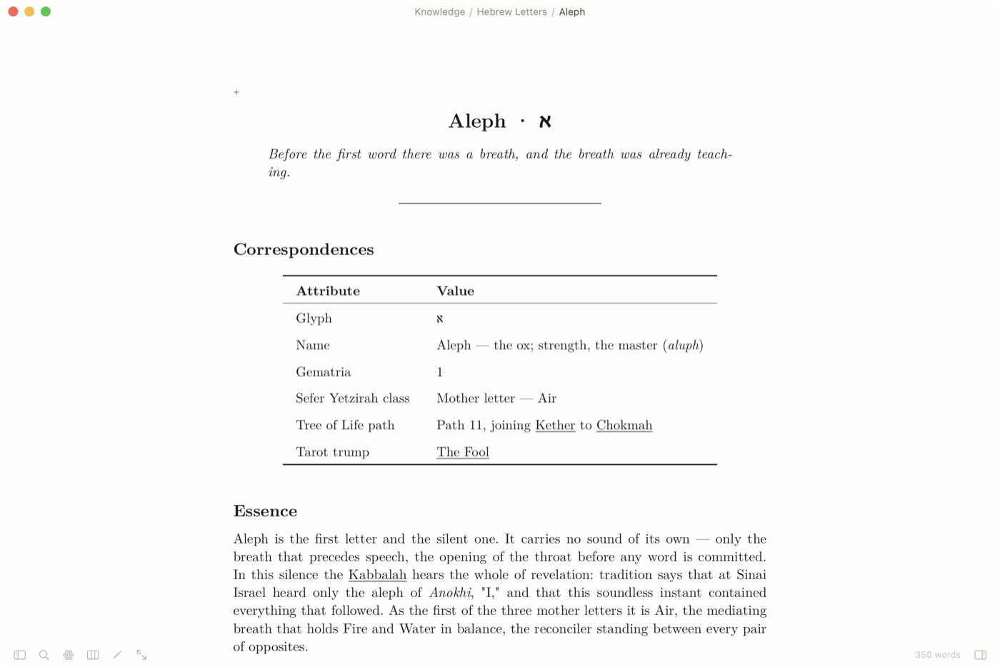

# Reading

Onyx opens a folder of `.md` files and gets out of the way. It edits like a calm text editor and reads like a typeset page — Latin Modern, hyphenated, ragged-right (justification is opt-in). Your Obsidian vault opens as-is. Obsidian can keep running right alongside it. Quiet, fast, and yours — no database, no account, no lock-in.

Two modes, one keystroke. The editor is IBM Plex Mono with live Markdown styling. The reader is the Reitz LaTeX theme: a measure you can set, Tufte-style sidenotes, footnotes, tables, callouts, and Mermaid figures. <kbd>⌘↩</kbd> (or <kbd>⌘E</kbd>) flips between them, saves, and keeps your place in the note. A single newline inside a paragraph is a line break, the way Obsidian does it unless “Strict line breaks” is on.

Typeset reading (on by default, Settings ▸ Reading) sets the page the way a book would: curly quotes and real dashes (never inside code), true small caps for acronyms, old-style figures in prose and lining tabular figures in tables, hyphenation in the note’s `lang`, ragged-right text (Settings ▸ Reading can turn on justification), hanging punctuation, a small-caps lead-in or drop cap, epigraphs, booktabs tables, and numbered figure and table captions. Choose Latin Modern or ET Book. Sidenotes stack and never collide, and they reflow when fonts, images, or the window change. Write `[^n]: {-} …` for an unnumbered margin note. When the window is narrow, notes fold behind a tap. Turn it off to get the plain Reitz LaTeX page back.

File ▸ Export as PDF… (<kbd>⇧⌘E</kbd>) and Print… (<kbd>⌥⌘P</kbd>) lay the note out as a book page. You get sidenotes as margin notes, a running head in small caps, and folios, and links keep working.

Frontmatter, `%%comments%%`, embeds, images, PDFs, audio and video all render in the reader. Dataview-lite runs the `TABLE` and `LIST` queries a vault actually uses (`FROM`, `WHERE`, `SORT`, `LIMIT`, and functions such as `choice()`, `join()`, and `contains()`).

Saves are atomic and conflict-aware: if the file changed on disk, Onyx offers to keep yours, take theirs, or keep both. Light, dark, or auto, text size, and line measure live in <kbd>⌘,</kbd>. <kbd>⌃⌘F</kbd> is focus mode — just the text.

Split with <kbd>⌘D</kbd> (side by side) or <kbd>⇧⌘D</kbd> (stacked), up to four panes. Drag the divider to resize (240pt minimum); double-click it to equalize. Each pane keeps its own note, its own history, and its own read/edit mode. <kbd>⌘W</kbd> closes the focused pane, or the window when there is only one.

See also [keyboard shortcuts](shortcuts.md) and [getting around](navigation.md).
